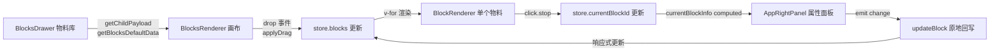

# LowCode · 低代码可视化搭建平台

一个基于 **Vue 3 + TypeScript + Vite** 的低代码（Low-Code）可视化页面搭建平台。通过「物料拖拽 + 属性配置 + 多端预览」的方式，让使用者在可视化的画布上快速搭建页面，无需手写前端代码。


---

## 一、项目简介

本项目实现了一个低代码编辑器的核心能力闭环：

- **物料库（Blocks）**：预置 8 类基础/外部物料（引述、笔记、标题、图片、视图、图表、按钮、表单），支持插件化扩展。
- **拖拽编排**：从左侧物料库拖入中间画布，支持排序、删除、复制。
- **属性配置**：右侧面板根据选中物料动态渲染对应的配置表单，实时回写。
- **多端预览**：支持「桌面端 / 移动端」双态预览与全屏切换。
- **运行态**：独立的只读渲染入口，模拟线上页面效果。
- **数据源 / 动作编排**：集成百万级数据表格（Glide Data Grid）与工作流编排（Vue Flow）。

---

## 二、技术栈

| 类别 | 技术 | 说明 |
| --- | --- | --- |
| 框架 | Vue 3.5 | `<script setup>` 组合式 API |
| 语言 | TypeScript 6.0 | 严格类型 + 联合类型建模 |
| 构建 | Vite 8（Rolldown） | 极速 HMR 与产物构建 |
| 状态管理 | Pinia 4 | Setup Store 风格 |
| 路由 | Vue Router 4 | 嵌套路由 + 异步组件 |
| 拖拽 | smooth-dnd 0.12 | Javascript drag&drop，自封装为 Vue 组件 |
| 表单校验 | vee-validate 4 | `useForm` / `defineField` |
| 图表 | ECharts 6 / zrender / d3 | 三种图表渲染策略 |
| 富文本 | Tiptap 3 | 笔记物料编辑器 |
| 工作流 | @vue-flow/core | 动作编排画布 |
| 表格 | @glideapps/glide-data-grid | React 表格，百万行数据 |
| 互操作 | veaury 2.6 | Vue ↔ React 混用 |
| 图标 | @icon-park/vue-next | 统一图标库 |
| JSON | vue-json-pretty | Schema 可视化与导出 |

---

## 三、快速开始

```bash
# 安装依赖
pnpm install

# 启动开发服务器
pnpm dev

# 类型检查 + 构建
pnpm build

# 预览构建产物
pnpm preview

# 代码检查
pnpm lint:es      # ESLint
pnpm lint:style   # Stylelint
pnpm lint:fix     # 自动修复
pnpm spellcheck   # 拼写检查

# 规范化提交（cz-git）
pnpm commit

# 单元测试
pnpm test
```

---

## 四、目录结构

```
src/
├── main.ts                      # 应用入口：创建 app、注册 Pinia/Router/setup
├── setup.ts                     # 物料注册（BlockSuite）+ 全局依赖注入
├── App.vue                      # 根组件（RouterView）
│
├── assets/                      # 全局样式
│   ├── reset.css / base.css     # 样式重置与基础样式
│   └── variable.css             # Design Token（CSS 变量）
│
├── types/                       # 类型定义
│   ├── block.ts                 # 物料数据模型（BlockInfo 联合类型）
│   └── veaury.d.ts              # veaury 模块类型声明
│
├── constants/                   # 常量与元数据
│   └── blocksBaseMeta.ts        # 物料元数据 + 默认数据工厂
│
├── mocks/                       # Mock 数据
│   └── blocks.ts                # 初始物料列表
│
├── stores/                      # Pinia 状态
│   ├── appEditor.ts             # 编辑器状态（物料列表 / 选中 / 增删改）
│   └── debug.ts                 # 环境开关（debug 模式）
│
├── router/                      # 路由配置
│   └── index.ts
│
├── blocks/                      # ⭐ 物料层（业务组件）
│   ├── BlockRenderer.vue        # 单个物料的包装（选中态 / 工具栏 / 删除）
│   ├── BlocksRenderer.vue       # 物料列表渲染 + 拖拽容器
│   ├── basic/                   # 基础物料
│   │   ├── QuoteBlock.vue       #   引述
│   │   ├── HeroTitleBlock.vue   #   超级标题
│   │   ├── ViewBlock.vue        #   视图
│   │   ├── ChartBlock.vue       #   图表
│   │   └── ImageBlock.vue       #   图片
│   └── external/                # 外部物料
│       ├── ButtonBlock.vue      #   按钮
│       ├── FormBlock.vue        #   表单
│       └── NotesBlock.vue       #   笔记（Tiptap）
│
├── components/                  # 编辑器框架组件
│   ├── AppNavigator.vue         # 顶部导航（数据源 / 布局 / 动作 / 发布）
│   ├── AppLeftPanel/            # 左侧面板
│   │   ├── AppLeftPanel.vue     #   面板容器（大纲 / 物料切换）
│   │   ├── OutlineDrawer.vue    #   大纲抽屉
│   │   └── BlocksDrawer.vue     #   物料库抽屉（拖拽源）
│   ├── AppRightPanel/           # 右侧面板
│   │   ├── AppRightPanel.vue    #   属性配置容器（动态渲染）
│   │   ├── QuoteSetting.vue     #   引述配置
│   │   ├── ChartSetting.vue     #   图表配置
│   │   └── SchemaExporter.vue   #   Schema JSON 导出
│   ├── AppEditorRenderer/       # 编辑器渲染区（laptop / mobile）
│   ├── AppRunnerRenderer/       # 运行态渲染区（只读）
│   ├── AppPreviewer/            # 预览器外壳（Laptop / Mobile）
│   ├── ChartRenderer/           # 图表渲染（三种策略）
│   │   ├── ChartRenderer.vue    #   策略分发
│   │   ├── EchartsRenderer/     #   ECharts 实现
│   │   ├── CanvasChartRenderer/ #   zrender 实现
│   │   └── SVGChartRenderer/    #   d3 实现
│   ├── FlowEditor/              # 动作编排（Vue Flow）
│   ├── NoteEdit/                # 笔记富文本（Tiptap + 自定义扩展）
│   ├── SmoothDnd/               # smooth-dnd 的 Vue 封装
│   └── DataSourceLeftPanel.vue  # 数据源列表
│
├── hooks/                       # 组合式函数
│   └── useClickOutside.ts       # 点击外部区域
├── ui/                          # 基础 UI 组件
│   └── SegmentedControl/        # 分段选择器
├── utils/                       # 工具函数
│   ├── array.ts                 # arrayMove
│   └── detect.ts                # 设备检测（isMobileTablet）
│
└── views/                       # 路由页面
    ├── AppView.vue              # 应用壳（导航 + 子路由）
    ├── PageLayoutView.vue       # 布局编排页（三栏编辑器）
    ├── RunnerView.vue           # 运行态页面
    ├── DataSourceView.vue       # 数据源页
    ├── DataSourceContent/       # 数据源内容（React 表格）
    ├── ActionsView.vue          # 动作编排页
    └── AboutView.vue            # 关于页
```

---

## 五、架构设计

### 5.1 分层架构

项目采用「**框架层 / 物料层 / 业务层**」的分层方式，核心是**物料与编辑器解耦**：

```
┌─────────────────────────────────────────────────────┐
│                     业务层 (views)                    │
│   PageLayoutView · RunnerView · DataSourceView · …    │
├─────────────────────────────────────────────────────┤
│                  编辑器框架层 (components)             │
│   三栏布局 · 拖拽容器 · 属性面板 · 预览器 · 图表渲染      │
├─────────────────────────────────────────────────────┤
│                     物料层 (blocks)                   │
│   Quote / HeroTitle / View / Chart / …  (可插拔)       │
├─────────────────────────────────────────────────────┤
│               基础设施 (types/constants/stores/utils)  │
│   数据模型 · 元数据 · 状态管理 · 工具函数                │
└─────────────────────────────────────────────────────┘
```

**关键思想**：编辑器框架（`components/`）只负责「编排、选中、预览、配置」这些通用能力，**不知道具体有哪些物料**；物料（`blocks/`）只负责「如何渲染自己」，**不关心编辑器如何工作**。二者通过一套统一的数据契约（`BlockInfo`）和依赖注入（`blocksMap`）解耦。

### 5.2 物料（Block）插件化体系

物料的注册与发现是整座架构的地基，由 [setup.ts](src/setup.ts) 中的 `BlockSuite` 完成：

```ts
class BlockSuite {
  getBlocksMap() { … }   // type -> { type, material } 映射
  addBlock(block) { … }  // 动态注册物料
  hasBlock(type) { … }   // 物料是否存在
}
```

- 基础物料在构造时注册，外部物料通过 `addBlock` **动态注册**，实现了「物料库插件化开发」。
- 注册表通过 **依赖注入** 暴露给渲染层：
  - `provide(blocksMapSymbol, blocksMap)` —— 供组合式 API 使用；
  - `app.config.globalProperties.$blocksMap` —— 供模板直接访问。
- [BlockRenderer.vue](src/blocks/BlockRenderer.vue) 用 `<component :is="$blocksMap[block.type].material" />` 按 `type` 动态解析物料组件，从而做到**新增物料无需改动渲染器**。

### 5.3 数据模型

核心类型定义在 [types/block.ts](src/types/block.ts)，用 **TypeScript 联合类型** 精确描述每一种物料：

```ts
interface BaseBlockInfo { id: string; label: string }

interface QuoteBlockInfo extends BaseBlockInfo {
  type: 'quote'
  props: { content: string; status: QuoteBlockStatus }
}

type BlockInfo = HeroTitleBlockInfo | ViewBlockInfo | ChartBlockInfo | …
```

配套的元数据与工厂函数在 [constants/blocksBaseMeta.ts](src/constants/blocksBaseMeta.ts)：

- `blocksBaseMetaList`：物料展示元数据（`type` / `label` / `icon`），供左侧物料库与大纲使用；
- `getBlocksDefaultData(type)`：**默认数据工厂**，用 `nanoid` 生成唯一 id 并返回带默认 `props` 的完整 `BlockInfo`，是拖拽新增物料的唯一数据来源。

### 5.4 状态管理

采用 **Pinia Setup Store** 风格，集中在 [stores/appEditor.ts](src/stores/appEditor.ts)：

| 状态 / 方法 | 说明 |
| --- | --- |
| `blocks` | 画布上的物料列表（`ref<BlockInfo[]>`） |
| `currentBlockId` | 当前选中的物料 id |
| `selectBlock(id)` | 更新选中态 |
| `updateBlocks(blocks)` | 整体替换（拖拽排序后回写） |
| `updateBlock(id, block)` | 原地更新单个物料（`Object.assign`，保持引用稳定） |

`updateBlock` 用 `Object.assign` 而非替换数组，**保证物料对象引用不变**，避免图表、富文本等有内部状态的组件因引用变化而重建。配套的 [stores/debug.ts](src/stores/debug.ts) 提供全局 `debug` 开关，用于切换物料选中框的显隐。

### 5.5 拖拽编排

拖拽能力基于 **smooth-dnd**，通过 [SmoothDnd/](src/components/SmoothDnd/) 封装为 Vue 组件：

- `SmoothDndContainer` / `SmoothDndDraggable`：桥接 smooth-dnd 的容器/子项 API 与 Vue 插槽。
- 左侧 [BlocksDrawer.vue](src/components/AppLeftPanel/BlocksDrawer.vue) 用 `behaviour="copy"` 作为**拖拽源**，`getChildPayload` 返回 `getBlocksDefaultData(type)`；
- 中间 [BlocksRenderer.vue](src/blocks/BlocksRenderer.vue) 用相同 `group-name` 作为**拖拽目标**，`applyDrag` 依据 `removedIndex` / `addedIndex` 区分「新增 / 移动」并回写 store。

> ⚠️ **重要实现细节**：Vue 3.5 的 block tree 优化下，若在 render 函数中手动调用 `this.$slots.default?.()`，会触发 `emitsOptions` 为 `null` 的运行时错误。此处必须改用 `renderSlot(this.$slots, 'default')` 来渲染插槽（详见 [SmoothDndContainer.ts](src/components/SmoothDnd/SmoothDndContainer.ts)）。

### 5.6 策略模式

多处采用「**策略模式**」按配置动态分发实现：

- **图表渲染**：[ChartRenderer.vue](src/components/ChartRenderer/ChartRenderer.vue) 根据 `blockInfo.props.chartType` 在 `EChartsRenderer`（渐变堆叠面积图）、`CanvasChartRenderer`（zrender 动态图形）、`SVGChartRenderer`（d3 中国地图）间切换；
- **属性面板**：[AppRightPanel.vue](src/components/AppRightPanel/AppRightPanel.vue) 根据选中物料的 `type` 动态渲染 `QuoteSetting` / `ChartSetting` 等配置组件；
- **多端预览**：[AppEditorRenderer.vue](src/components/AppEditorRenderer/AppEditorRenderer.vue) 在 `LaptopPreviewer` / `MobilePreviewer` 间切换。

### 5.7 编辑态 / 运行态

同一个物料渲染器被「编辑态」与「运行态」复用，通过 **`provide/inject('editable')`** 区分：

- **编辑态**（`PageLayoutView`）：`editable = true`，物料可选中、可拖拽、显示工具栏；
- **运行态**（`RunnerView`）：[AppRunnerRenderer.vue](src/components/AppRunnerRenderer/AppRunnerRenderer.vue) 中 `provide('editable', false)`，物料只读渲染，模拟线上页面。

### 5.8 React / Vue 混用

数据源表格使用 React 组件 **Glide Data Grid**（支持百万行虚拟滚动），通过 **veaury** 无缝混入 Vue：

- [DataSourceContent.vue](src/views/DataSourceContent/DataSourceContent.vue) 用 `applyPureReactInVue(ReactDataSource)` 将 React 组件包装为 Vue 组件；
- [vite.config.ts](vite.config.ts) 通过 `veauryVitePlugins({ type: 'vue' })` 提供跨框架 JSX 转换，并对 `react` / `react-dom` 做 `dedupe` 与 `manualChunks` 分包，保证 React 仅存在一份实例。

### 5.9 Design Token

样式体系基于 **CSS 变量** 实现主题化，定义于 [assets/variable.css](src/assets/variable.css)：

- 色板：灰阶（`--color-gray-100~900`）、蓝阶（`--color-blue-*`）、主题色 `--color-primary`；
- 字号/字重：`--font-size-*`、`--font-weight-*`；
- 布局：`--panel-width: 320px`（左右面板宽度统一）。

所有物料与框架组件均引用变量而非硬编码，保证视觉一致与后续主题定制能力。

---

## 六、业务模块

### 6.1 布局编排（Layout）⭐ 核心

路由 `/app/layout`，三栏编辑器结构：

```
┌──────────┬───────────────────────────────┬──────────┐
│  左侧面板  │           中间渲染区             │  右侧面板  │
│ 大纲/物料库 │   laptop / mobile 预览 + 画布    │  属性配置  │
└──────────┴───────────────────────────────┴──────────┘
```

- **左**：`AppLeftPanel` 在「大纲」与「物料库」两个抽屉间切换；物料库提供可拖拽的物料卡片。
- **中**：`AppEditorRenderer` 提供桌面/移动双态预览，画布内物料可拖拽排序、点击选中、悬停显示工具栏（拖拽手柄 / 删除）。
- **右**：`AppRightPanel` 渲染选中物料的配置表单，并附带 Schema JSON 导出器。

### 6.2 数据源（DataSource）

路由 `/app/dataSource`，左侧为数据源列表，右侧 [DataSourceContent](src/views/DataSourceContent/DataSourceContent.vue) 展示基于 Glide Data Grid 的**百万行数据表格**，验证大数据量下的流畅渲染。

### 6.3 动作编排（Actions）

路由 `/app/actions`，基于 **Vue Flow** 的工作流编排画布，支持节点拖拽、连线、缩放、迷你地图与图数据导出（`toObject`）。

### 6.4 预览 / 运行（Runner）

路由 `/runner`，只读态渲染物料列表，模拟最终发布的页面效果；编辑区内部的桌面/移动预览则用于搭建过程中的即时查看。

### 6.5 发布

顶部导航「发布」按钮（当前为占位），是未来将编排结果导出为可部署页面的入口。

---

## 七、核心数据流

以下以「拖入一个引述物料 → 选中 → 修改内容」为例，梳理完整的数据闭环：



1. **拖拽新增**：物料库 `getChildPayload` 调用 `getBlocksDefaultData` 生成带唯一 id 的默认物料；落入画布后 `applyDrag` 将其 splice 进 `blocks`。
2. **选中**：点击物料触发 `selectBlock`，更新 `currentBlockId`。
3. **配置回写**：右侧面板的 `currentBlockInfo` 依据 `currentBlockId` 定位物料，动态渲染对应配置组件；配置组件 `emit('change', newBlock)`，`updateBlock` 用 `Object.assign` 原地更新，画布随之响应式刷新。

---

## 八、工程化

### 8.1 代码规范

| 工具 | 用途 |
| --- | --- |
| ESLint（typescript-eslint + eslint-plugin-vue） | JS/TS/Vue 规范 |
| Stylelint | 样式规范 |
| cspell | 拼写检查 |
| commitlint + cz-git + commitizen | 规范化提交（带 emoji 的 Conventional Commits） |
| husky + lint-staged | 提交前钩子自动检查与修复 |

### 8.2 构建

- **Vite 8（Rolldown）**：`vite.config.ts` 中通过 `veauryVitePlugins` 支持跨框架，`manualChunks` 采用函数形式（Rolldown 不支持对象形式）将 Vue 生态与 React 生态分别拆包；`rollup-plugin-visualizer` 生成产物分析报告 `bundle-analysis.html`。
- **TypeScript**：采用 Project References（`tsconfig.json` → `tsconfig.app.json` / `tsconfig.node.json`），`@` 别名指向 `src/`，开启 `noUnusedLocals` / `noFallthroughCasesInSwitch` 等严格选项。

---

## 九、已知问题 / TODO

- 部分物料（`HeroTitle` / `View` / `Image` / `Button` / `Form`）仍为占位实现，尚未接入真实的 `props` 数据渲染。
- 存在少量未使用的变量与 `react-dom/client` 类型声明缺失，`vue-tsc` 尚有若干告警待清理。
- 「发布」流程、数据源接入、动作编排与物料的联动尚未打通。

---

## 十、目录约定与命名

- 物料组件统一命名为 `*Block.vue`，置于 `blocks/basic`（基础）或 `blocks/external`（外部）。
- 配置组件统一命名为 `*Setting.vue`，置于 `AppRightPanel`。
- 渲染器统一命名为 `*Renderer.vue`。
- 组件通过 `@/` 别名导入，第三方图标统一使用 `@icon-park/vue-next`。
