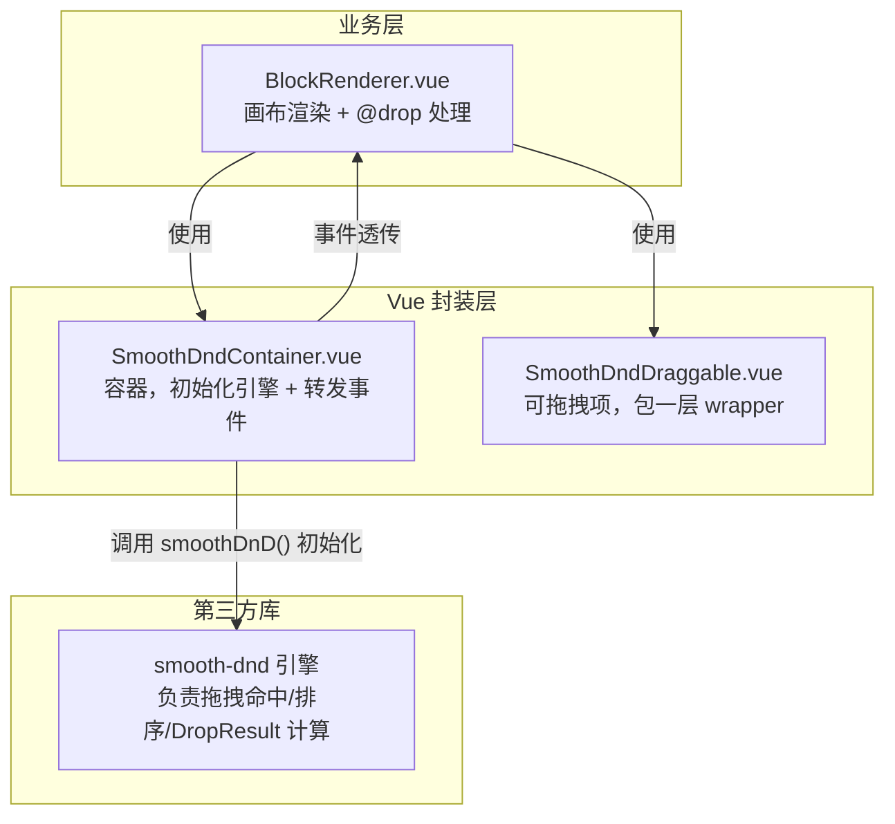
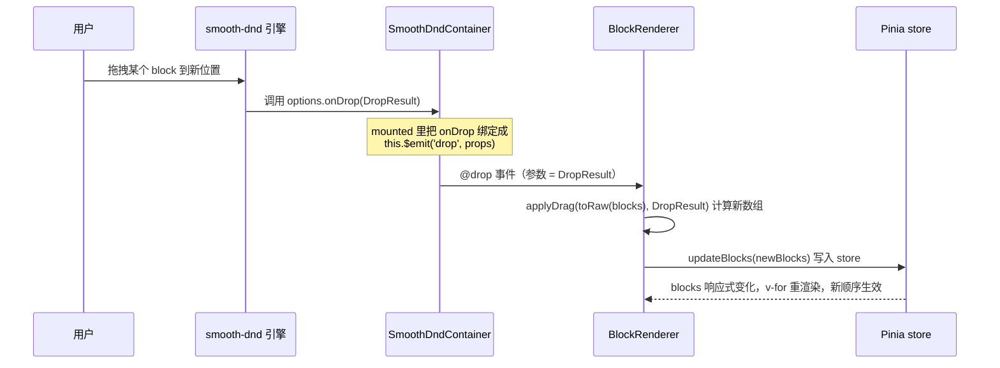
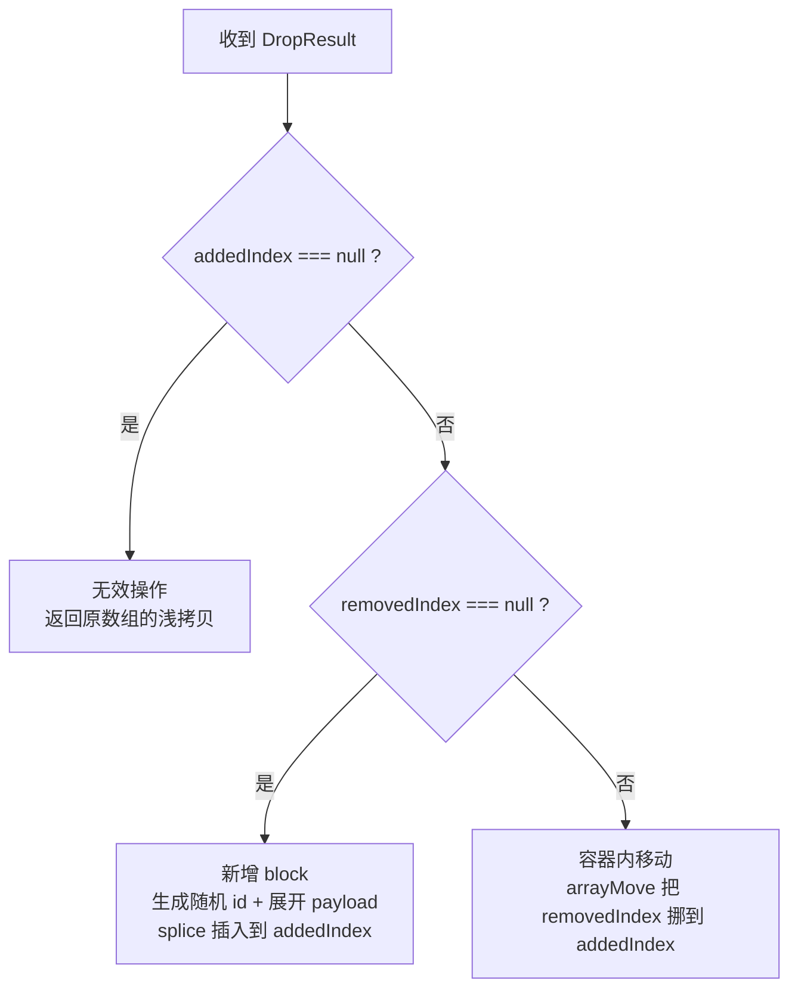
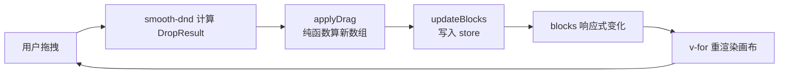

# Block 拖拽逻辑分析

> 分析对象：`src/blocks/BlockRenderer.vue` 中 `smooth-dnd-container` 的 `@drop` 事件处理
> 核心问题：为什么写 `updateBlocks(applyDrag(toRaw(blocks), $event))`，直接传 `applyDrag` 不行吗？

---

## 一、涉及的角色与职责

拖拽能力由第三方库 `smooth-dnd` 提供，项目在其上做了两层封装，再接入业务组件。分层如下：



### 各角色职责

| 角色 | 文件 | 职责 |
|---|---|---|
| smooth-dnd 引擎 | 第三方库 | 处理拖拽手势、命中检测、跨容器拖放，最终产出 `DropResult` |
| `SmoothDndContainer` | `src/components/SmoothDnd/SmoothDndContainer.ts` | 把 smooth-dnd 的回调（`onDrop` 等）转成 Vue 事件 `@drop` 抛出 |
| `SmoothDndDraggable` | `src/components/SmoothDnd/SmoothDndDraggable.ts` | 给每个可拖拽项包一层 `wrapper`，内容走默认插槽 |
| `BlockRenderer` | `src/blocks/BlockRenderer.vue` | 业务画布：渲染 block 列表，处理 `@drop` 更新状态 |
| `appEditor` store | `src/stores/appEditor.ts` | 持有 `blocks` 状态，提供 `updateBlocks` 唯一的写入口 |

---

## 二、事件链路的完整数据流

smooth-dnd 是「命令式」的库，`SmoothDndContainer` 在 `mounted` 里手动初始化，并把库的回调桥接成 Vue 事件：



关键桥接代码在 [SmoothDndContainer.ts:51-62](src/components/SmoothDnd/SmoothDndContainer.ts#L51-L62)：

```ts
mounted() {
  const options: any = Object.assign({}, this.$props)
  for (const key in eventEmitterMap) {
    const eventKey = key as EventKey
    options[eventEmitterMap[eventKey]] = (props: any) => {
      this.$emit(eventKey, props)   // 把库回调转成 Vue emit
    }
  }
  const containerElement = this.$refs.container || this.$el
  this.container = smoothDnD(containerElement, options)
}
```

其中 `eventEmitterMap` 把 `drop` 映射到库的 `onDrop`，所以库触发 `onDrop` 时，容器组件就 `$emit('drop', DropResult)`，业务层用 `@drop` 接住。

---

## 三、`DropResult` 与 `applyDrag` 的三种分支

`DropResult` 是 smooth-dnd 每次放置后给出的结果，关键字段：

- `removedIndex`：被拖走项在**原数组**的索引（从外部拖入时为 `null`）
- `addedIndex`：要放入的**目标索引**（拖到容器外/取消时为 `null`）
- `payload`：被拖拽项携带的数据（新 block 的元信息等）

`applyDrag` 是纯函数，根据这三个字段算出「新数组」，逻辑分三支：



对应源码 [BlockRenderer.vue:25-47](src/blocks/BlockRenderer.vue#L25-L47)：

```ts
const applyDrag = <T extends any[]>(arr: T, dragResult: DropResult) => {
  const { removedIndex, addedIndex, payload } = dragResult
  const result = [...arr]   // 浅拷贝，保证不可变更新

  if (addedIndex === null) return result              // ① 取消/拖出容器：原样返回

  if (addedIndex !== null && removedIndex === null) { // ② 从组件库拖入新 block
    result.splice(addedIndex, 0, { id: `${Math.random()}`, ...payload })
  }

  if (addedIndex !== null && removedIndex !== null) { // ③ 容器内调换顺序
    return arrayMove(result, removedIndex, addedIndex)
  }

  return result
}
```

三种场景对应：

| 场景 | removedIndex | addedIndex | 处理 |
|---|---|---|---|
| 取消 / 拖出容器 | 有值或 null | `null` | 返回原数组，不变 |
| 从组件库拖入新 block | `null` | 有值 | 用 `payload` 造新 block，插入到目标位置 |
| 画布内调整顺序 | 有值 | 有值 | `arrayMove` 交换位置 |

> 说明：`arrayMove`（[src/utils/array.ts](src/utils/array.ts)）同样是纯函数，`slice` + `splice` 返回新数组，不修改入参。

---

## 四、核心问题：为什么 `updateBlocks` 要包裹 `applyDrag`

### 1. `applyDrag` 只「算」不「写」

`applyDrag` 是一个**纯函数**：入参是数组 + 拖拽结果，返回值是新数组，**它不修改任何状态、不产生副作用**。

而 `@drop` 事件处理表达式的**返回值会被 Vue 丢弃**——Vue 只把它当表达式执行，不会把返回值拿去做任何事。

所以如果直接写：

```html
@smooth="applyDrag(toRaw(blocks), $event)"   <!-- 错误示范 -->
```

`applyDrag` 算出的新数组被白白丢掉，`store.blocks` 没有任何变化，画布**不会重排**，拖拽看起来"没反应"。

### 2. `updateBlocks` 是唯一的「写」入口

store 里 `blocks` 的更新收敛在一个 action 上，[appEditor.ts:13-15](src/stores/appEditor.ts#L13-L15)：

```ts
function updateBlocks(newBlocks: typeof blocksData) {
  blocks.value = newBlocks
}
```

`updateBlocks(applyDrag(...))` 本质是下面两步的组合：

```ts
// 等价写法
const newBlocks = applyDrag(toRaw(blocks), $event)  // ① 算出新数组
updateBlocks(newBlocks)                              // ② 写入 store
```

所以「包裹」不是多余的，而是**「计算」与「提交」分离**：

- `applyDrag` 负责回答「拖完之后，blocks 应该长什么样」；
- `updateBlocks` 负责回答「把这个结果写回 store」；
- `@drop` 的表达式把这两步串起来：**先算，再写**。

### 3. 这样拆分的好处

1. **纯函数可测试**：`applyDrag` 不依赖 Vue/Pinia，传数组和 DropResult 就能断言结果。
2. **单一数据流**：状态变更只有 `updateBlocks` 一个出口，逻辑清晰。
3. **职责单一**：`applyDrag` 不关心数据从哪来、写到哪；`updateBlocks` 不关心数据怎么算出来的。

---

## 五、`toRaw(blocks)` 的作用

`blocks` 来自 `storeToRefs(appEditorStore)`，是一个**响应式 ref（Proxy 包装）**。

```ts
const { currentBlockId, blocks } = storeToRefs(appEditorStore)
```

`toRaw(blocks)` 剥掉 Proxy，拿到**原始普通数组**，再传给 `applyDrag`。目的是：

1. **纯函数不碰响应式代理**：`applyDrag` 内部 `[...arr]` 拷贝的是原始数据，避免隐式触发依赖收集、语义更干净。
2. **避免纯函数与响应式系统耦合**：`applyDrag` 只处理"值"，不感知 Vue 的响应式机制。
3. 计算完成后，再由 `updateBlocks` 把**新的普通数组**重新赋给 `blocks.value`，重新建立响应式——这一进一出形成闭环。

---

## 六、单向数据流总结

整个拖拽是标准的「用户操作 → 计算 → 提交 → 重渲染」单向数据流：



一句话概括：

> **`applyDrag` 负责「算什么」，`updateBlocks` 负责「写哪里」，`toRaw` 负责「给纯函数喂原始数据」；三者组合成 `updateBlocks(applyDrag(toRaw(blocks), $event))`，缺一不可。**

---

## 附：待完善点

- 新增 block 的 id 目前用 `Math.random()` 生成（[BlockRenderer.vue:36](src/blocks/BlockRenderer.vue#L36)），生产环境建议换成更可靠的唯一 id 方案（如 `crypto.randomUUID()`）。
- 组件库 `BlocksDrawer.vue` 目前还是占位，尚未真正作为拖入来源（`removedIndex === null` 的分支已预留，但拖入源还未接好）。
